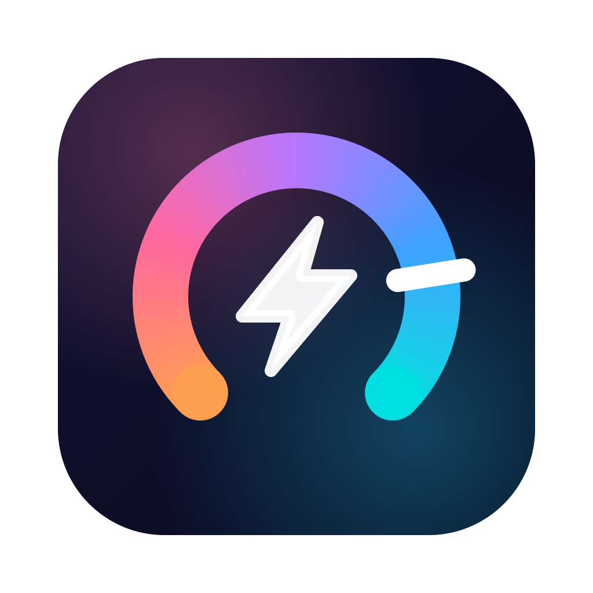
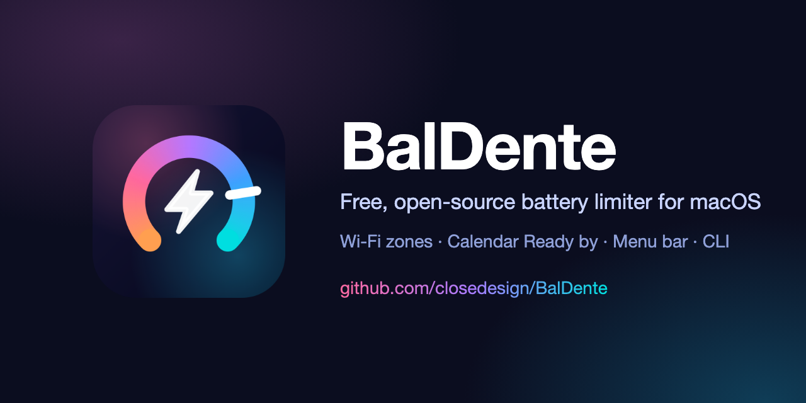
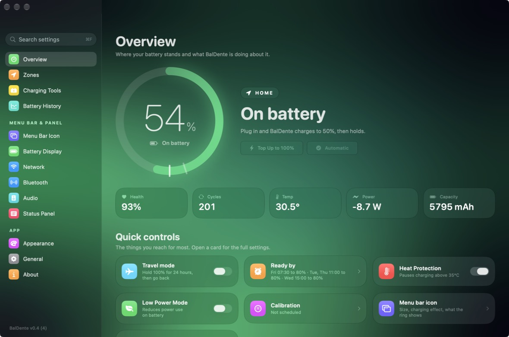
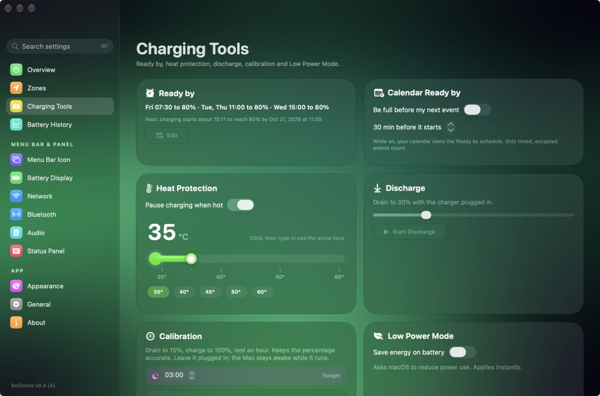
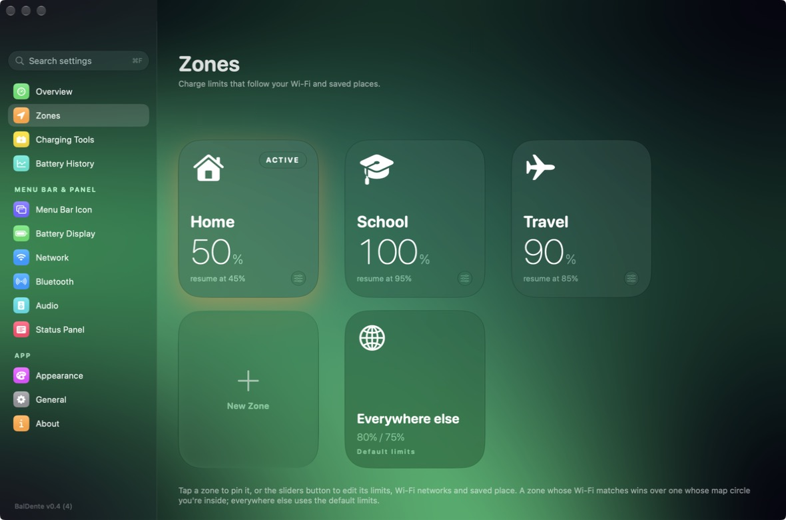
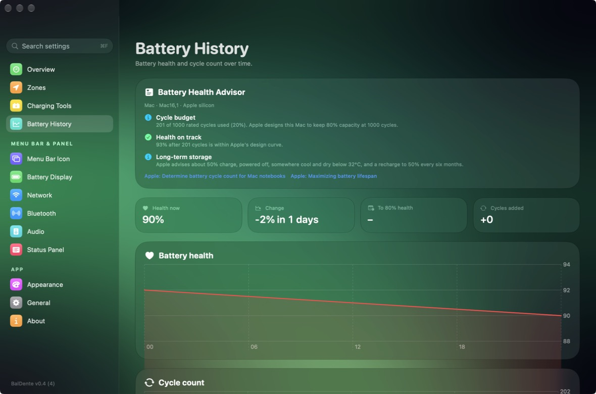
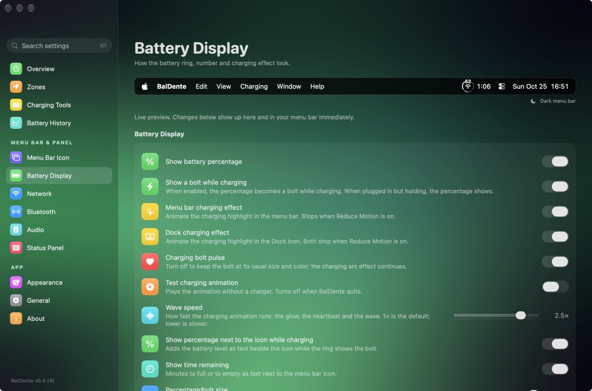
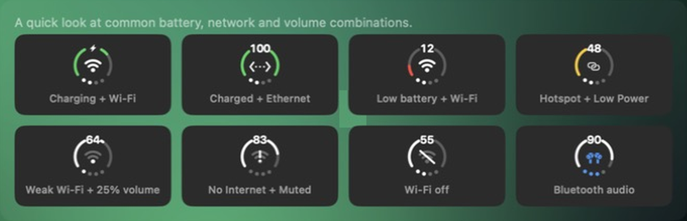

<p align="center">
  
</p>

<h1 align="center">BalDente</h1>

<p align="center">
  <b>The free, open-source battery charge limiter for macOS.</b><br>
  A free alternative to AlDente and BattOpt, with Wi-Fi zones, scheduling and a menu bar that actually tells you things.
</p>

<p align="center">
  
  
  <a href="https://github.com/closedesign/BalDente/releases/latest"></a>
  <a href="https://ko-fi.com/closedesign"></a>
</p>

<p align="center">
  <a href="https://github.com/closedesign/BalDente/releases/latest"><b>⬇️ Download the latest release</b></a>
</p>



## Screenshots

<table>
  <tr>
    <td></td>
    <td></td>
  </tr>
  <tr>
    <td></td>
    <td></td>
  </tr>
  <tr>
    <td colspan="2"></td>
  </tr>
</table>

## Why BalDente?

Keeping a MacBook at 100% all day wears the battery faster. Holding it around 80% when it is plugged in is the usual
fix, and it has been a paid feature in other apps. **BalDente does it for free, with no paid tier, no account and no
tracking.** The source is here, so you can read exactly what the helper does.

> BalDente is not affiliated with AlDente or BattOpt. "Alternative to" describes what it is for.

## Zones: automatic limits by place (free here)

> **This is the feature other battery limiters usually put behind a paid upgrade. In BalDente it is free.**

A **zone** is a charge limit that switches on by itself, based on where you are:

- **By Wi-Fi network:** add your home, school or office networks to a zone and its limit applies the moment you connect.
- **By saved place:** draw a circle on a map for places with no known Wi-Fi.
- **Each zone has its own limit** (and resume level when Sailing is on), a name, an icon and its own background color.
- **Out of the box BalDente limits charging to 80%** (it resumes at 75%), so a Mac that lives on its charger
  stops sitting at a full charge. The starter zones are **Home** (80%), **School** (80%), **Travel** (100%), and **Everywhere else** (80%)
  for anywhere that matches no zone. Add your Wi-Fi to a zone and its limit applies automatically; lower a zone's limit for more battery life.
- **The first-run tour shows these defaults up front** and offers a simpler **80% everywhere** instead. While charging is held
  below 100%, Overview and the menu bar panel say why ("Holding at 80% (Home zone)") with one-click Top Up and Ready by. Plugged in but not charging, it says "Using AC power" and the panel shows the power source (Power Adapter or Battery) like the macOS battery menu.
- **Every zone switch is announced** with its reason (for example "connected to HomeNet" or "you pinned it").
- Pin any zone by hand, or tap **Automatic** to let Wi-Fi and location decide again.
- Create as many zones as you like, rename them, and back them up with **Export settings**.

## One icon for battery, network and volume (a Status Trio alternative)

BalDente's menu bar icon combines **battery, network and volume in a single icon**, the idea popularized by
[Status Trio](https://github.com/lingyired/status-trio) by lingyired (Apache-2.0). BalDente's icon design and settings are modeled on it, drawn with BalDente's own code,
and credited in [NOTICE](NOTICE). The difference is what's behind it: it is also your battery charge limiter, so **one app replaces both**,
with a charging wave animation, percentage and time remaining beside the icon, and a status panel for Wi-Fi, Bluetooth and audio.
(BalDente is not affiliated with Status Trio.)




Ring color shows the battery state, the middle shows your connection (Wi-Fi bars, Ethernet, hotspot, a Bluetooth device, or the percentage), and the
four dots at the bottom are the volume.

## All features

**Charging control**
- Charge limit applied by a small root helper through the SMC. By default charging resumes one point under the limit; turn on **Sailing** (Charging page, off by default) to use a separate, lower resume level per zone (hysteresis). Pausing charging cuts the charger on current Macs, so a wide band runs the Mac from the battery.
- **macOS Charge Limit:** macOS can hold 80, 85, 90 or 95% itself and run the Mac from the charger. BalDente reads your setting from
  System Settings > Battery automatically (or you can pick a step by hand), and zones at that limit are left to macOS; when a zone needs more, the card says which step to pick ("Travel needs 100%. macOS is set to 80%.") with an **Open Battery Settings** button, once per change. Icon-only buttons show hover text. Zones below it still use BalDente.
- **Keep charging while busy:** when the Mac is working hard and the battery has only just reached its limit, the charger stays on for up to 2 more points (on by default, Charging page).
- **On battery while plugged in:** History shows the hours each day the charger was cut at your limit, so you can see what a limit costs on this Mac.
- **Drag the ring:** on Overview, drag the markers on the battery ring to set where charging stops (and where it resumes, with Sailing on),
  for whichever zone is active (or "Everywhere else").
- **Top Up to 100%** for a trip, then back to your zone's limit.
- **Travel mode:** hold 100% for 24 hours, then return to normal.
- **Charge normally for a while:** from the menu bar panel's clock button, lift the limit for 1, 2, 4 or 24 hours; it ends on its own.
- **Ready by:** per-day schedule (days, leave time, target charge, optionally only in one zone). Charging is timed to
  finish just as you leave, and the Mac wakes itself to start when needed. If a zone-limited schedule can't start because another
  limit is active, you get a notification instead of finding out at the door. Within a day of leaving, Overview shows when charging
  will start, or why it won't (wrong zone, not plugged in).
- **Travel time:** tell Ready by when you must *arrive* and how long the trip takes; it finishes charging when you leave. Overview's
  "Leaving" card also warns if the battery is too hot for the top-up to run.
- **Schedule:** run Top Up, Discharge, Calibration or Low Power Mode on a schedule (daily, weekdays, weekly, every two weeks, monthly,
  yearly, once), with catch-up for a Mac that was asleep and a history of what ran. Needs the charger in and the Mac not shut down.
- **Sleep:** stop charging as the Mac goes to sleep, and/or keep it awake only until it reaches the limit.
- **Automatic Discharge:** when your limit drops below the battery, drain to it on its own.
- **MagSafe LED (experimental):** green at the limit, orange while charging, or pick your own colour for each state, on Macs that expose the LED.
- **Gauge and Power flow:** the battery's own percentage next to macOS's, and watts from charger and battery to the Mac.
- **Automation:** `baldente://` links for Shortcuts' "Open URLs" action and `baldente get state|percent|limit|temperature|zone` for
  "Run Shell Script" (full list and Shortcuts tips under [Automation](#automation)). General has Copy list and Copy command path buttons. No native Shortcuts actions yet.
- **Calendar Ready by:** reads your next timed event (Calendar access, event start time only) and gets you full a set time before.
- **Habit suggestions:** learns when you usually unplug, per weekday, and suggests a Ready by plan ("You usually unplug around 8:10
  on weekdays. Charge to 100% by 8:00?"). It only suggests: nothing changes until you tap Accept. The last 8 weeks of unplug times
  stay on your Mac, and you can turn it off or clear them in General. Answer straight from the notification (Accept / Not now).
- **Zone suggestions:** notices a Wi-Fi network you join regularly that no zone has ("You're on “CafeNet” most Tue, Thu") and
  offers to add it to a zone or make a new one. Suggest only, on-device, last 4 weeks.
- **Heat Protection:** pauses charging when the battery gets hot (never below 20%, so a hot day can't run it flat; Recent changes says when it charges anyway). While it holds, the Overview charts the temperature and estimates when charging resumes. Limit from 30 to 60 °C, default 35 °C, set with a thermometer
  you can drag, click, or type into (↑ ↓ ← →, ⇧ for 5), with presets.
- **Discharge** to a chosen level with the charger plugged in.
- **Calibration:** drain to 15%, charge to 100%, rest an hour. Run now, at a chosen time tonight, or repeat on days of the month. Pause and resume it, turn on **Calibrate overnight** (once a month, when you plug in at night), and see how long the drain will take. Shows live progress and how long it has been running, stops by itself if it can't finish within 24 hours, never runs twice in one night, notifies you when it finishes and remembers the last completed date, nudges you after 90 days without one and marks each on the History chart.
- **Low Power Mode** switch, plus **Save energy on battery** to turn it on whenever the Mac runs from its battery.
- **Install helper** button on every charging card while the helper isn't running, so greyed-out controls say why.

**Menu bar and Dock icon**
- One combined icon: battery ring, network glyph and volume dots, in the menu bar, the Dock, or both.
- Charging **wave and comet animation** (one crest travels the ring per cycle) (adjustable wave speed; stops with Reduce Motion), optional Dock animation, bolt pulse.
- Percentage and **time remaining** as text beside the icon; the percentage stays visible while charging.
- Ring colors by state (low is red, Low Power Mode is yellow, power is green), adjustable low-battery threshold and
  "full" level (can follow your charge limit), icon size, stroke width, number and bolt size.
- Middle slot shows Wi-Fi, Ethernet, hotspot, a Bluetooth audio device, the input source, or the percentage.
- Live preview and a gallery of icon states in settings.

**Always know what changed**
- A notification for every limit change, always with the reason: zone switches, Ready by and calendar top-ups starting and
  finishing, heat protection, accepted habit plans, Top Up, Travel mode, discharge and calibration, and a helper that stopped
  answering. Mute any kind separately.
- **Recent changes** on Overview lists what changed, when and why, and survives restarts.
- A short, skippable **guided tour** on first launch that spotlights each control in the real window (replay it from General, About
  or the Help menu), and a **What's New** sheet after each update. Tour steps can do the thing they describe: allow Location,
  add your current Wi-Fi to Home in one click, or open the menu bar panel.

**Status panel** (click the icon, or set a global shortcut)
- Battery, Network, Bluetooth, Volume, plus optional Microphone, Input Source and VPN sections, reorderable and hideable.
- A compact panel (at most 520 pt tall) that fades at the bottom and shows a "More" button when there's more to scroll; Settings and Quit stay pinned.
- Zone pins (they fold into one menu when you have many zones), Top Up, and a clock menu to charge normally for a while.
- Local IP address, Bluetooth device battery levels, a Bluetooth on/off switch, scroll to change volume (natural scrolling option),
  output device list.

**History and health**
- Daily log of battery health and cycle count with charts, a **Battery Health Advisor** built from Apple's published figures
  for your Mac model, and CSV export. Reset the log after a battery replacement.
- **Time above 80% per zone:** hours each zone kept the battery above 80% this week. When one zone does it a lot, BalDente suggests
  lowering its limit to 80% (only when you tap).

**Look and feel**
- Background follows the active zone, or pick one of 20 color presets, or choose your own colors, in four styles (Aurora, Gradient, Spotlight, Midnight); optional animation; Light, Dark or System window theme.
- **Compact mode:** a dense standard Mac layout in a small window. The regular window resizes down to about 640 x 470.
- **Search settings** with ⌘F: type a word and jump to (and highlight) the setting.
- Launch at login, status refresh interval, smart notifications (battery health drops),
  export and import all your settings, **Copy diagnostics** for bug reports (no Wi-Fi names or places), reset icon and panel settings.
- The window remembers its size, position and last page; closing it keeps BalDente running in the menu bar.
- Right-click the menu bar icon for a quick menu: Top Up and pin a zone.
- Command line tool: `baldente status | get <value> | limit <upper> <lower> | enable | disable`.

**Updates**
- **Check for updates** button in General plus an optional daily automatic check (one request to GitHub; it only tells you, never installs).
  **Install** (when the release has a DMG) downloads, verifies and swaps the app for you. After an update it confirms your settings
  are unchanged, and keeps the last five settings backups with a Restore button, all under About.
  Updating keeps your zones, limits, Ready by and appearance. **What's New** under About lists the changes in every version.

**Free, open source, and private**
- MIT licensed, no account, no tracking, no network access from the helper. Optional donations in the app (About, Overview) and below.

## Install

1. Download `BalDente.dmg` from [Releases](https://github.com/closedesign/BalDente/releases/latest) and drag BalDente to
   Applications.
2. The app is **not notarized yet** (it is ad-hoc signed). The first time, right-click it → **Open**, or allow it in
   System Settings → Privacy & Security → **Open Anyway**.
3. Open BalDente and click **Install** under *Charging helper*. macOS asks for your password once. When an update ships
   you will see **Update Helper** and one more prompt.

Requires **macOS 26 or later**. Developed and tested on a MacBook (Mac16,1) running macOS 27. Other Macs should work, and
reports are welcome; see [Compatibility](#compatibility).

### Build it yourself

```bash
swift build                # debug build
swift test                 # unit tests
./make_app.sh --dmg        # dist/BalDente.app and dist/BalDente.dmg
./install.sh               # build, install to /Applications, launch
```

## How it works, and what it can touch

Changing the charge limit needs root, so BalDente installs a small helper, `baldented`, as a LaunchDaemon. It listens on
a local Unix socket, applies the limit through the Mac's SMC, and does nothing else: no network access, no analytics.

- **Location** access is used only to read Wi-Fi names and saved places for zone switching.
- **macOS Charge Limit** is read with `pmset -g battlimit` (no extra permission); BalDente never changes macOS's own setting (it is gated by a private Apple entitlement), it only opens System Settings > Battery.
- **Calendar** access is used only for the start time of your next timed event when *Calendar Ready by* is on.
- **Habit suggestions** record only unplug times and weekdays (and zone exits on battery) in `habits.json`, and Wi-Fi names that
  no zone has in `network-habits.json`, both on your Mac. Nothing is uploaded.
- Remove the helper any time: **General → Charging helper → Remove**.

Battery charging is a hardware-adjacent feature. Read [SECURITY.md](SECURITY.md) and the code if you want to be sure.

## Command line

```bash
baldente status            # battery %, adapter, limiter state
baldente limit 80 75       # hold at 80%, resume at 75%
baldente enable            # turn limiting back on
baldente disable           # stop limiting
baldente get percent       # one bare value: state, percent, limit, temperature or zone
```

## Automation

For Shortcuts ("Open URLs" action), scripts and `open` in Terminal. Every link run is logged in **Recent changes**.

| Link | Does |
|---|---|
| `baldente://topup` / `topup/off` | Start or cancel Top Up to 100% |
| `baldente://travel/on` / `travel/off` | Travel mode (hold 100% for 24 h) |
| `baldente://discharge/60` | Discharge to a level (20 to 90%) |
| `baldente://calibrate` | Start a calibration (ignored if one is running) |
| `baldente://lowpower/on` / `lowpower/off` | Low Power Mode |
| `baldente://automatic` | Un-pin a zone and let Wi-Fi and location decide |
| `baldente://zone/Home` | Pin an existing zone by name (case-insensitive; spaces as `%20`). Links can't create zones |
| `baldente://cancel` | Cancel the running task |

### Using it with Shortcuts

- **Run something:** add an **Open URLs** action with one of the links above (for example `baldente://zone/Travel`, or `baldente://topup`
  from a "When I leave work" automation). Links only do reversible things and are range-checked.
- **Read something:** add **Run Shell Script** and use the command's full path, because Shortcuts has no `PATH`:
  `/Applications/BalDente.app/Contents/Resources/baldente get percent`. **General → Settings file and support → Copy command path**
  copies it for you.
- Ideas: pin Travel when a Focus turns on, Top Up before a calendar trip, notify when `get state` says `HeatProtect`.
- There are no native Shortcuts actions yet: App Intents need Xcode's metadata step, which this Swift Package build doesn't run.

## Compatibility

| Mac | Status |
|---|---|
| MacBook, Apple silicon (Mac16,1), macOS 27 | Tested |
| Other Apple silicon MacBooks, macOS 26+ | Expected to work, not yet tested |
| Intel Macs, macOS 25 and older | Not tested (the app requires macOS 26) |

Different Macs expose different charging controls. If yours doesn't work, open an issue and include the output of
`swift run smcprobe`.

## Support BalDente

BalDente is free and will stay free. If it saved your battery, you can chip in:

<p>
  <a href="https://ko-fi.com/closedesign"></a>
  <a href="https://www.buymeacoffee.com/closedesign"></a>
</p>

Starring the repo and telling a friend helps just as much.

## Contributing

Issues and pull requests are welcome. See [CONTRIBUTING.md](CONTRIBUTING.md). Hardware reports (your Mac model and
`smcprobe` output) are especially useful.

## Credits and license

MIT licensed, see [LICENSE](LICENSE). The menu bar icon design is modeled on
[Status Trio](https://github.com/lingyired/status-trio) (Apache-2.0); see [NOTICE](NOTICE).
